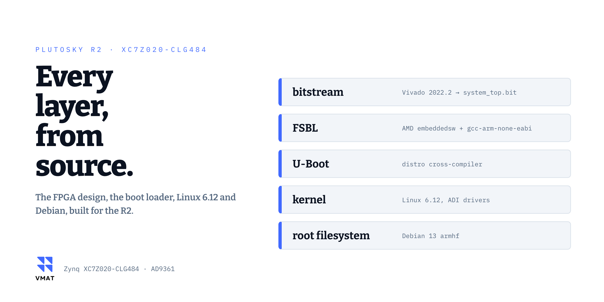
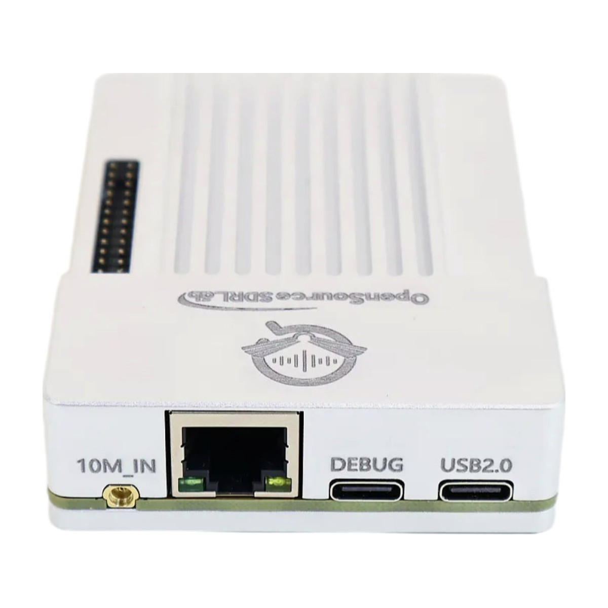
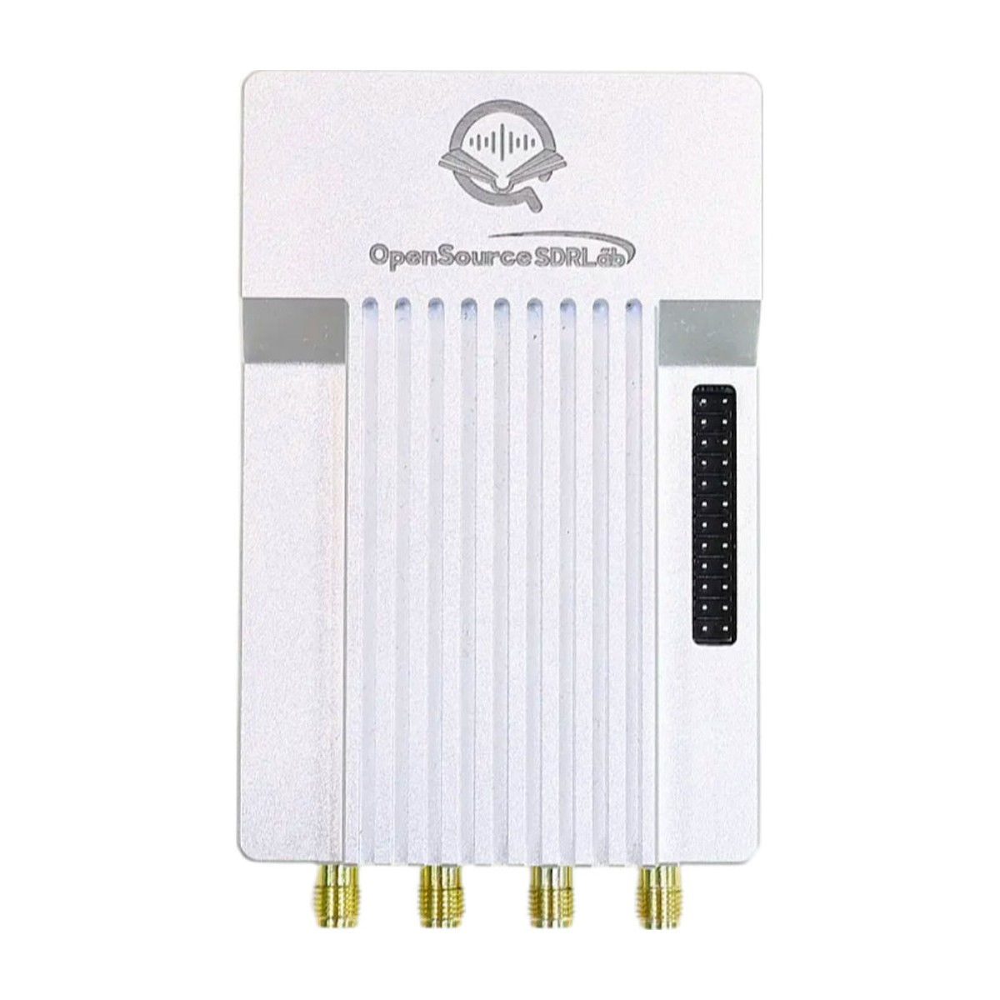
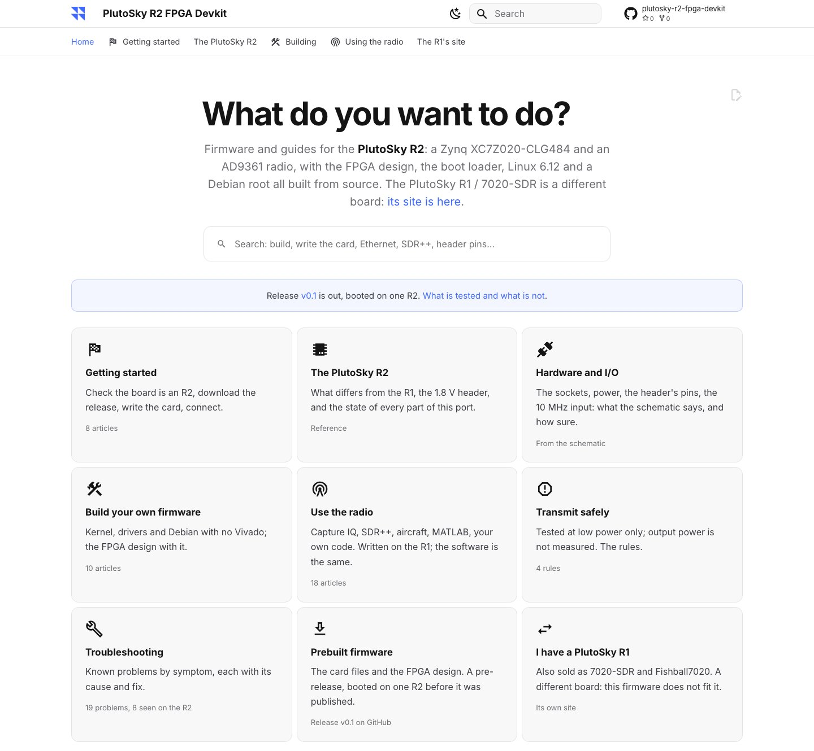
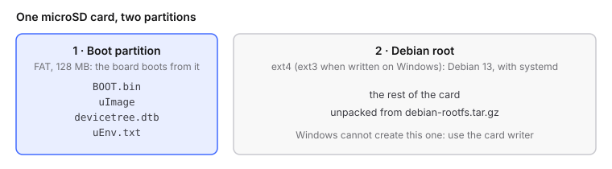

<p align="center">
  <picture>
    <source media="(prefers-color-scheme: dark)" srcset="docs/img/covers/devkit-stack-dark.png">
    
  </picture>
</p>

# PlutoSky R2 Devkit

**Editable, rebuildable firmware for the PlutoSky R2, from the FPGA design to the Debian root.**

<p align="center">
  <a href="https://matsvandamme.github.io/plutosky-r2-fpga-devkit/"></a>
  <a href="https://github.com/matsvandamme/plutosky-r2-fpga-devkit/releases/tag/v0.1"></a>
  
  <a href="LICENSE"></a>
  <a href="../../actions/workflows/verify-patches.yml"></a>
  <a href="../../actions/workflows/verify-modern.yml"></a>
</p>

<p align="center">
  
  
  <br><sub>The PlutoSky R2 in its case: ports end, and from above. Photos: OpenSourceSDRLab.</sub>
</p>

> **This repository is for the PlutoSky R2 only.** The PlutoSky R1 / 7020-SDR / Fishball7020 is a different board with its own repository: **[fishball7020-fpga-devkit](https://github.com/matsvandamme/fishball7020-fpga-devkit)**. An image for one does not work on the other: an R1 image on an R2 boots with no radio, no Ethernet and no USB. Not sure which you have? [Is this your board?](#is-this-your-board)

> **A young port.** One PlutoSky R2 has run this firmware, and its transmit power has not been measured. Read [where this stands](#-where-this-stands) before you rely on it.

## 📚 Documentation

**Everything is on the documentation site: [matsvandamme.github.io/plutosky-r2-fpga-devkit](https://matsvandamme.github.io/plutosky-r2-fpga-devkit/).** Short task articles with diagrams, searchable, with the reference pages one click deeper.

<p align="center">
  <a href="https://matsvandamme.github.io/plutosky-r2-fpga-devkit/"></a>
</p>

| I want to… | Start at |
|---|---|
| get a board running | **[Start here](https://matsvandamme.github.io/plutosky-r2-fpga-devkit/start/)**: six short steps from the box to a board running this firmware |
| know what differs from the R1, and what is tested | **[The PlutoSky R2](https://matsvandamme.github.io/plutosky-r2-fpga-devkit/plutosky-r2/)** |
| transmit without breaking anything | **[Before you transmit](https://matsvandamme.github.io/plutosky-r2-fpga-devkit/start/before-you-transmit/)**: four rules |
| find a socket, the header voltage or the schematic | **[Hardware and I/O](https://matsvandamme.github.io/plutosky-r2-fpga-devkit/hw/)** |
| change the kernel, a driver, the device tree or the FPGA | **[Build your own firmware](https://matsvandamme.github.io/plutosky-r2-fpga-devkit/build/)** |
| receive, use SDR++ or Python | **[Use the radio](https://matsvandamme.github.io/plutosky-r2-fpga-devkit/radio/)** |
| fix a problem | **[Troubleshooting](https://matsvandamme.github.io/plutosky-r2-fpga-devkit/troubleshooting/)** |

The guides under *Use the radio* were written and measured on the **R1**. The software is the same on both boards, so the commands apply; the measured numbers, the photographs and anything about transmit power are the R1's until someone measures an R2. The R1's hardware pages (its ports, its header, its schematic) are not copied here; they are on the [R1's documentation site](https://matsvandamme.github.io/fishball7020-fpga-devkit/hw/), as is the [Fabric School course](https://matsvandamme.github.io/fishball7020-fpga-devkit/course/).

## 🌟 Highlights

Each line is in the R2's firmware, with what was checked on an R2 and where the checking stops.

- **Every layer builds from source**: the FPGA design, the first-stage boot loader, U-Boot, the kernel, the device tree and the Debian root.
- **The FPGA design builds with Vivado 2022.2 and meets timing** (WNS +0.100 ns). Two builds gave the same bitstream.
- **No Vivado needed for the rest.** The release ships the built design as an `.xsa` file; the boot loader, kernel and Debian root build around it. Only an FPGA change needs Vivado.
- **A current system**: Linux 6.12 LTS from Analog Devices and Debian 13. On the one R2 that has run it, it boots in about 21 s with no failed services.
- **Ethernet at 1 Gbit/s**, which on the R2 goes through the FPGA: DHCP, `fishball.local`, ssh and iiod.
- **Transmitters that start muted**: both come up at 89.75 dB of attenuation, and each mutes when its program stops, is killed or stops sending data. Tested at low power through attenuators; transmit power is not measured ([before you transmit](docs/start/before-you-transmit.md)).
- **Both receive channels go through the FPGA's ÷8 decimation filter**, where the upstream design filters only one. Measured on one R2 through loops: tones well outside the decimated window come out 86 dB or more down on both channels ([both receive channels](docs/both-receive-channels.md)).
- **A self-test and a transmit gate**: `./devkit selftest` passes 24 of 24 checks on the R2 with no cable, and the transmitting tools refuse to run until you record `./devkit tx-guard affirm <0|1>` for the channel.

## 🧪 Where this stands

One PlutoSky R2 has run this firmware. Release **[v0.1](https://github.com/matsvandamme/plutosky-r2-fpga-devkit/releases/tag/v0.1)**, a pre-release, was booted on it on 2026-11-21.

| | State on the R2 |
|---|---|
| FPGA design builds with Vivado 2022.2, timing met (WNS +0.100 ns) | **done** |
| boots to Debian 13 / Linux 6.12 from the SD card, about 21 s to a running system, no failed services | **works** |
| radio found, receives samples; both transmitters come up muted (89.75 dB) | **works** |
| Ethernet: 1 Gbit/s, DHCP, `fishball.local`, ssh and iiod | **works** |
| USB: the board enumerates and its network interface comes up | **works** on the board's side with release v0.1 (the host was a Mac, which has no driver for RNDIS) |
| USB network to a Mac: the board switched to `ncm`, handing the Mac its address by DHCP | **works**, with firmware built after v0.1: it is in the next release |
| a card made with `./devkit write-card --from` a release, through an image file (`--image`) copied to the card | **works** |
| `./devkit write-card` straight to a card reader | **not done** for an R2 |
| transmit, both channels, at low power through attenuators; mutes when its program stops, is killed or starves | **works** |
| transmit power | **not measured** |
| the four sample-locked header pins, the 10 MHz reference input | **not tested** |
| `./devkit selftest` and `./devkit tx-guard` | **work** |
| `./devkit flash`: boot loader, kernel and device tree onto the running board, with a reboot | **works**, run from a Mac, with the files already on the card |
| the host tools from a Mac: `ssh-key`, `net`, `status`, `selftest --ssh`, `flash` | **work** |
| the Mac card writer | **not run** for an R2: the card it wrote was the R1's release, booted in an R1 |
| `./devkit container` on an Apple Silicon Mac | **not run** for the R2 from this repository: it built the R1 repository's targets |
| the Windows card writer | **not run** for an R2 |
| a second R2, an AD9363 unit, a unit with a power amplifier | **none tried** |

The full list, with how each item was checked: [what is tested and what is not](docs/plutosky-r2.md#what-is-tested-and-what-is-not).

## ℹ️ Overview

The PlutoSky R2 is a Zynq XC7Z020-CLG484 (two ARM cores plus FPGA fabric) with an AD9361 radio chip: two transmit and two receive channels, Ethernet through the FPGA, a 10 MHz reference input and a 1.8 V header. This repository builds its firmware from source, so you can open the FPGA design, put your own logic next to the radio's datapath and rebuild everything around it. SDR software reaches the board at `ip:fishball.local`.

> **Not the official Analog Devices / OpenSourceSDRLab repository.** This is an independent port. The vendor's own schematic and source are at [OpenSourceSDRLab/PlutoSky-R2](https://github.com/OpenSourceSDRLab/PlutoSky-R2).

### Is this your board?

| | PlutoSky R2 (this repository) | PlutoSky R1 / 7020-SDR ([the other one](https://github.com/matsvandamme/fishball7020-fpga-devkit)) |
|---|---|---|
| Zynq package, printed on the chip | XC7Z020-**CLG484** | XC7Z020-**CLG400** |
| Extra socket on the case | `10M_IN`, a 10 MHz reference input | none |
| Vendor v0.38 firmware version | `v0.38-5-g76414` | `v0.38-4-g95aad` |
| QSPI flash | 32 MB (W25Q256) | 16 MB (W25Q128) |

The vendor sells the R2 with an AD9361 or an AD9363, and with or without a power amplifier. Only one AD9361 unit has run this firmware. More ways to tell, and what differs inside: [check you have an R2](docs/start/right-board.md) · [the PlutoSky R2](docs/plutosky-r2.md).

### The header is 1.8 V

> [!WARNING]
> The R2's `JP5` header is 2×12 pins at **1.8 V**, and **pin 1 is 5 V**. The R1's is 2×10 at 3.3 V. A cable or a circuit made for an R1 does not carry over: check it against the [vendor schematic](https://github.com/OpenSourceSDRLab/PlutoSky-R2) first. [The pins this firmware drives](docs/plutosky-r2.md#the-sample-locked-gpio-pins-on-the-r2).

### Two halves of one build

`./devkit` drives both: the second by default, the first with `--target factory`.

| | [`firmware/`](firmware/README.md) | [`firmware-modern/`](firmware-modern/README.md) |
|---|---|---|
| builds | the FPGA design, into an `.xsa` file | the boot loader, Linux 6.12, the device tree and the Debian 13 root, around that `.xsa` |
| needs | Vivado 2022.2 | an ARM cross-compiler; never Vivado |

Here the factory target builds only the FPGA design. There is no R2 build of the vendor's 5.15 kernel or of a Buildroot root: the R1 repository has both, for the R1.

### How it relates to the R1 repository

This repository started as a copy of [fishball7020-fpga-devkit](https://github.com/matsvandamme/fishball7020-fpga-devkit) and shares its history up to 2026-11-21. What the R2 changes sits on top of the R1's files, which are still here because they are its inputs:

| Part | Where the R2's comes from |
|---|---|
| FPGA design | [`firmware/patches/`](firmware/patches/) (the R1 series) with [`firmware/revs/r2/patches/`](firmware/revs/r2/README.md) replacing two of its patches and adding one: the vendor's R2 design, then this devkit's FPGA changes on R2 pins |
| First-stage boot loader | generated from the R2 design's `.xsa`, which sets the pin-mux and the 3.3 V bank |
| U-Boot | the R1's source, unchanged |
| Kernel | the R1's configuration plus [`config/r2.config`](firmware-modern/config/r2.config) |
| Device tree | [`zynq-pluto-sdr-fishball-r2.dts`](firmware-modern/dts/zynq-pluto-sdr-fishball-r2.dts), which includes the R1's and overrides Ethernet, two pins and the model |
| Debian root | the same |

## ⬇️ Installation

The card does not touch the firmware the board shipped with: that is in its QSPI flash, and setting the `BOOT` switch to QSPI (`1 0`) boots it again.

**From the release**, on a Linux PC with a card reader. Download every file of **[v0.1](https://github.com/matsvandamme/plutosky-r2-fpga-devkit/releases/tag/v0.1)** into one folder, then:

```bash
# run from: wherever you want the devkit to live (e.g. ~)
git clone https://github.com/matsvandamme/plutosky-r2-fpga-devkit.git
cd plutosky-r2-fpga-devkit
gunzip -c ~/Downloads/debian-rootfs.tar.gz > firmware-modern/debian/rootfs.tar
sudo ./devkit write-card --from ~/Downloads /dev/sdX      # DESTROYS the card
```

The card that booted was made with `--image` and copied to the card; writing straight to a reader, as above, has not been done for an R2 yet.

**On macOS** the same command takes `/dev/diskN` (`diskutil list external physical` names it) and needs no `gunzip` line: with `--from`, the Mac writer takes `debian-rootfs.tar.gz` as it is. That writer was tested with the R1's release: a card it wrote booted in an R1 on 2026-11-21. It has not written an R2 card. [Use the devkit on a Mac](docs/start/use-a-mac.md#write-a-card).

<p align="center">
  <picture>
    <source media="(prefers-color-scheme: dark)" srcset="docs/img/start-card-dark.svg">
    
  </picture>
</p>

**Or build it.** Everything but the FPGA design builds without Vivado, around the design the release ships:

```bash
# run from: the repo root
./devkit doctor                          # can this machine build?
./devkit setup                           # the kernel and boot-loader source, ~0.6 GB
./devkit build --all --xsa "$(./firmware-modern/fetch-pinned-xsa.sh)"
sudo ./devkit write-card /dev/sdX        # DESTROYS the card
```

**On a Mac** the host tools (`ssh-key`, `status`, `net`, `flash`, `selftest --ssh`) run as they are, with no `sshpass`: they were run from a Mac on the R2. The build runs in `./devkit container` with Docker through Colima, which has built the R1 repository's targets and not yet the R2 from this one. The USB network needs the board switched to `ncm`, with firmware from the next release. What was tested, and on which board: [use the devkit on a Mac](docs/start/use-a-mac.md).

**Changing the FPGA** needs Vivado 2022.2 (on Ubuntu 18.04 to 22.04, or in the container `./devkit container` builds for you):

```bash
# run from: the repo root
./devkit setup --target factory          # hdl/ only, ~0.2 GB
./devkit build --target factory          # -> firmware/src/hdl/projects/pluto/system_top.xsa
./devkit build --boot-only --xsa firmware/src/hdl/projects/pluto/system_top.xsa
```

Read the timing summary the FPGA build prints: a design that misses timing still produces a bitstream.

Then put the card in, set the **`BOOT`** switch to SD (both sliders away from `ON`), connect **both** USB-C sockets for power, and plug in Ethernet. Step by step: **[start here](docs/start/index.md)**.

## 🚀 Usage

With the card in and the board on your network, it answers after about half a minute:

```bash
# run from: the repo root
ssh root@fishball.local    # password: analog
./devkit ssh-key           # never type the password again: then just `ssh fishball`
./devkit status            # what is built, what the board is running
./devkit selftest          # is the radio damaged? no cable, never transmits
```

The self-test's baselines are the R1's. From a Mac, use Ethernet with release v0.1: the board's USB network is RNDIS, which macOS has no driver for. From the next release the board can be switched to `ncm`, which macOS drives ([on a Mac](docs/start/use-a-mac.md#reach-the-board-over-the-usb-cable)).

Then pick a starting point under [use the radio](docs/radio/index.md): [capture IQ](docs/capturing-iq.md), [SDR++](docs/sdrpp.md) or [aircraft overhead](docs/adsb.md). Those guides were written on the R1.

After the first card, `./devkit flash --kernel-only` puts a changed kernel on the running board over the network. It has been run on one R2, from a Mac, each time with the release's own files. It does not check which board answers: do not point it at an R1.

> [!CAUTION]
> ### Before you ever transmit
> Transmit has been tested on one R2 only at low power, through attenuators, and **its output power has not been measured**: the loop showed about 7.5 dB more gain than on the R1, so do not assume the R1's figures. The rules written for the R1 are the ones to start from: the receive port of an AD9361 board survives about **+2.5 dBm**, a board with a power amplifier puts out far more than that, so **never loop TX back to RX without at least 20 dB of attenuation**, and never transmit at power into an open port. The devkit's transmitting tools refuse to run until you record `./devkit tx-guard affirm`. Read [transmitter safety](docs/transmitter-safety.md) first.

`./devkit help` lists every command and `./devkit help <command>` explains one; `./devkit completion install` adds tab completion (bash and zsh; for the current shell only, `eval "$(./devkit completion)"`).

## 💭 Feedback and contributing

Something not working on your R2? Try [troubleshooting](docs/troubleshooting.md), then [open an issue](../../issues/new/choose) and say what you see: one board has run this, so a second report is worth a lot. Contributions are welcome: [CONTRIBUTING.md](CONTRIBUTING.md). People who shaped the firmware this builds on are in [CONTRIBUTORS.md](CONTRIBUTORS.md).

The repository's own scripts, patches and documentation are GPL-2.0; downloaded upstream sources keep their licenses, and Vivado and AMD IP are proprietary ([LICENSE](LICENSE)). [`.claude/skills/goal-creator/`](.claude/skills/goal-creator/VENDORED.md) is a vendored third-party skill under MIT.

## 📖 Further reading

- **[The documentation site](https://matsvandamme.github.io/plutosky-r2-fpga-devkit/)** ([above](#-documentation)), or the [documentation map](docs/README.md): every page, by what you want to do.
- **[The PlutoSky R2](docs/plutosky-r2.md)**: what differs from the R1, where each part of the build comes from, and what is tested.
- **[Build your own firmware](docs/build/index.md)**: the two halves of the build, then changing one part.
- **[`firmware/`](firmware/README.md)**, **[`firmware/revs/r2/`](firmware/revs/r2/README.md)** and **[`firmware-modern/`](firmware-modern/README.md)**: what is in each directory, and the rules that save an hour.
- **[How it works](docs/how-it-works.md)**: what a build produces and why, assuming nothing. Written for the R1.
- The vendor's **[schematic and source](https://github.com/OpenSourceSDRLab/PlutoSky-R2)** and **[user manual](https://blog.opensourcesdrlab.com/archives/plutosky-R2)**.
- The R1's **[repository](https://github.com/matsvandamme/fishball7020-fpga-devkit)** and **[documentation site](https://matsvandamme.github.io/fishball7020-fpga-devkit/)**, which has that board's hardware pages, its measurements and the Fabric School course.
