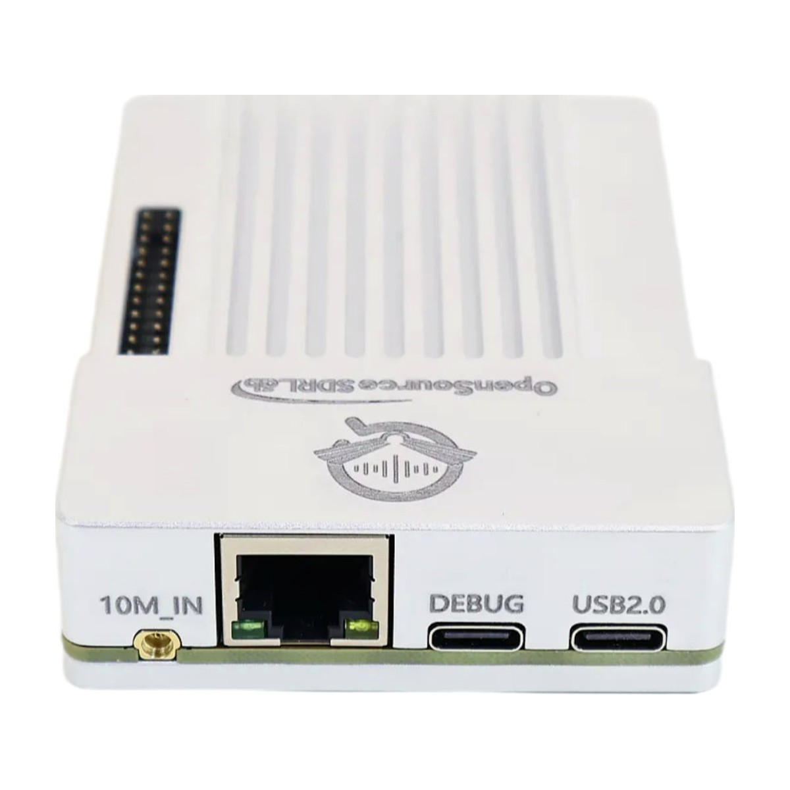
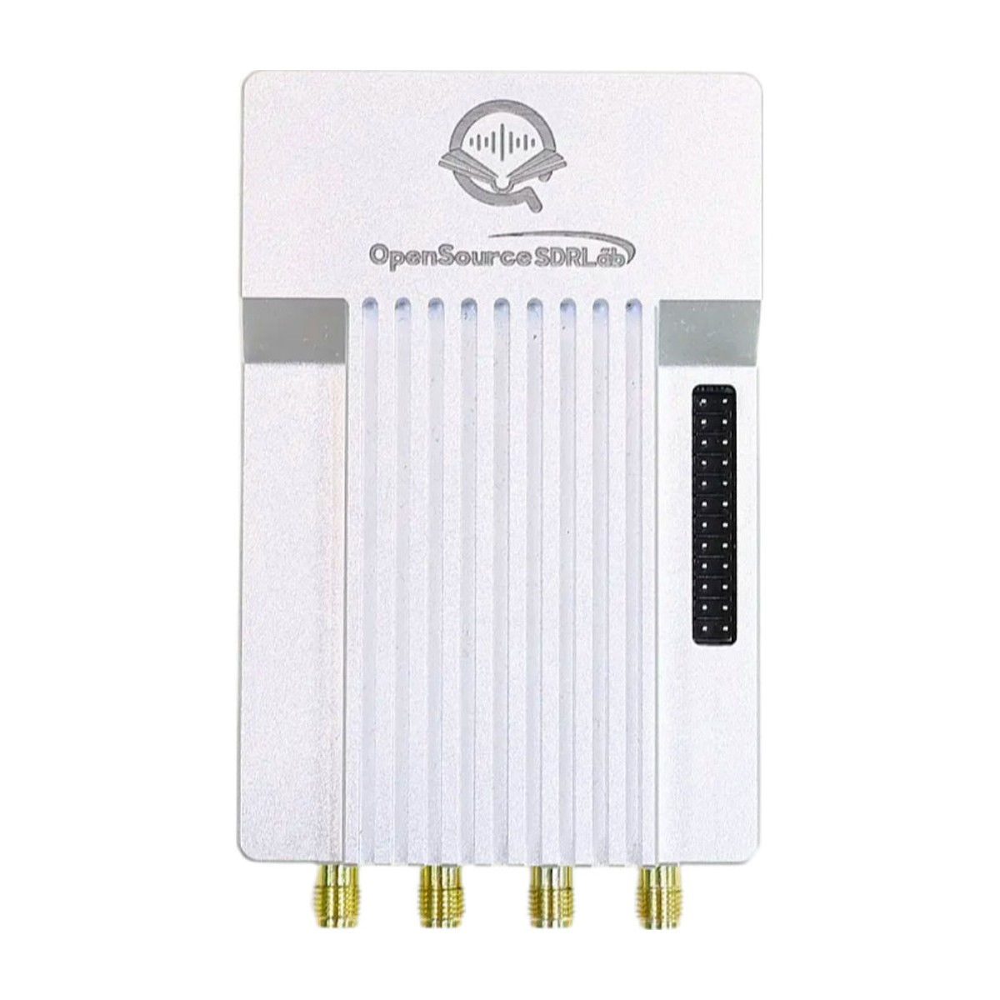

# Hardware and I/O

What this site knows about the R2's hardware fits on one page, and most of it
comes from the vendor's schematic rather than from a bench:
**[the PlutoSky R2](../plutosky-r2.md)**.

<figure markdown>
{ width="320" style="display:inline-block" }
{ width="320" style="display:inline-block" }
<figcaption>The PlutoSky R2 in its case: ports end, and from above. Photos: OpenSourceSDRLab.</figcaption>
</figure>

| Question | Answer, and how sure |
|---|---|
| Which socket is which? | `ETH`, two USB-C sockets marked `DEBUG` and `USB2.0`, `10M_IN`, and the SMA ports. `DEBUG` carries the serial console (115200 baud) and power; `USB2.0` is the board's USB device port. Seen on one board |
| How do I power it? | both USB-C sockets, as the [vendor's manual](https://blog.opensourcesdrlab.com/archives/plutosky-R2) says. [What was seen with one](../plutosky-r2.md#power-usb-and-the-vendors-manual) |
| What voltage is the `JP5` header? | **1.8 V**, with **5 V on pin 1** and ground on pins 2, 22 and 24. From the schematic; not probed |
| Which header pins does this firmware drive? | four, `sample_gpio0`–`3`, on pins 7, 9, 11 and 13. [The table](../plutosky-r2.md#the-sample-locked-gpio-pins-on-the-r2). Built into the design; not tested |
| How does the 10 MHz input work? | an ADF4001 PLL, programmed by the FPGA, locks the 40 MHz reference to `10M_IN`. The design does what the vendor's does; nothing here reads the lock |
| Where is the schematic? | [OpenSourceSDRLab/PlutoSky-R2](https://github.com/OpenSourceSDRLab/PlutoSky-R2), `hardware/PlutoSky-R2_Schematic.pdf` |
| Where is the `BOOT` switch set? | SD: both sliders away from `ON`. QSPI, the factory firmware: `1 0` |

!!! danger "An R1 cable or circuit does not carry over"
    The R1's `JP5` is 2×10 pins at 3.3 V. The R2's is 2×12 at 1.8 V with 5 V
    on pin 1. Check anything you connect against the R2 schematic.

## The R1's hardware pages

The R1 devkit documents its board in detail: every port, the header, GPIO from
Linux, the sample-locked outputs, the USER LED, the reference clock. Those
pages describe **another board** and are not copied here. Two of them explain
features this firmware also builds for the R2, and are worth reading for how
the feature works, not for where its pins are:

- [Sample-locked GPIO](https://matsvandamme.github.io/fishball7020-fpga-devkit/tx-gpio-bitmap/):
  four pins that follow the transmitted samples. The R2 build has it, on other
  pins and at 1.8 V.
- [The USER LED](https://matsvandamme.github.io/fishball7020-fpga-devkit/user-led/):
  lit while a transmitter is live. The R2's LED is on another processor pin
  (MIO 7), which its device tree accounts for; not checked on the board.

Everything else: [the R1's hardware section](https://matsvandamme.github.io/fishball7020-fpga-devkit/hw/).
