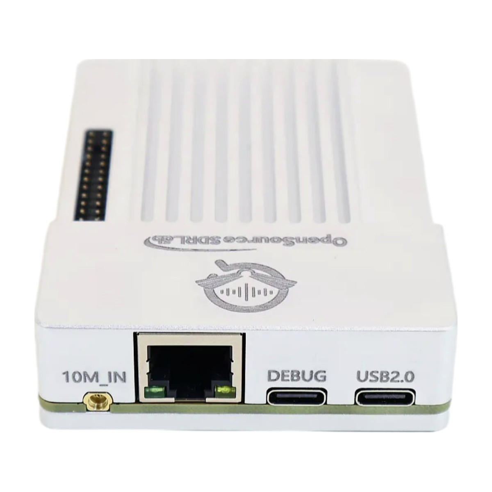
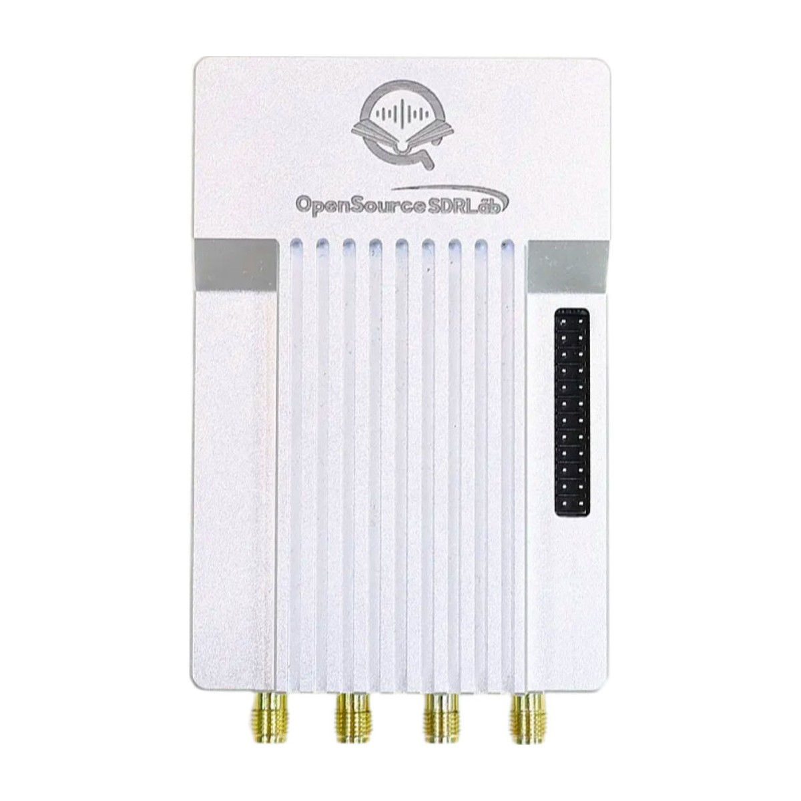

# Check you have an R2

This firmware fits the **PlutoSky R2** only. Its predecessor, sold as PlutoSky
R1, 7020-SDR, Fishball7020 and Fish-Wan, looks similar and needs
[the other repository](https://github.com/matsvandamme/fishball7020-fpga-devkit).
The wrong image boots Linux with no radio, no Ethernet and no USB.


<figure markdown>
{ width="320" style="display:inline-block" }
{ width="320" style="display:inline-block" }
<figcaption>The PlutoSky R2 in its case: ports end, and from above. Photos: OpenSourceSDRLab.</figcaption>
</figure>


| | PlutoSky R2: this firmware | PlutoSky R1 / 7020-SDR: the other one |
|---|---|---|
| Zynq package, printed on the chip | XC7Z020-**CLG484** | XC7Z020-**CLG400** |
| Socket on the case | `10M_IN`, a 10 MHz reference input | none |
| `JP5` header | 2×12 pins | 2×10 pins |
| QSPI flash | 32 MB (W25Q256) | 16 MB (W25Q128) |
| Vendor v0.38 firmware version | `v0.38-5-g76414` | `v0.38-4-g95aad` |

With the board on the firmware it shipped with, ask it (needs `libiio-utils` on
your PC; `192.168.2.1` is its USB network address):

```bash
# run on your HOST, from anywhere
iio_attr -C -u ip:192.168.2.1 fw_version
```

| It says | |
|---|---|
| `v0.38-5-g76414`, with or without `-dirty` | **an R2: fits** |
| `v0.38-4-g95aad` | an R1: use [the other repository](https://github.com/matsvandamme/fishball7020-fpga-devkit) |
| something else | go by the package printed on the Zynq |

Once it runs this firmware, the model reads
`FISH Ball PlutoSDR R2 (Z7020/AD9361)`:

```bash
# run on the board
cat /proc/device-tree/model
```

Checked on **one** R2, the one this port was made on. The vendor sells the R2
with an AD9361 or an AD9363 and with or without a power amplifier; only an
AD9361 unit has run this firmware, and nothing here has measured an R2's
transmitter.

**Next:** [gather what you need](what-you-need.md).
